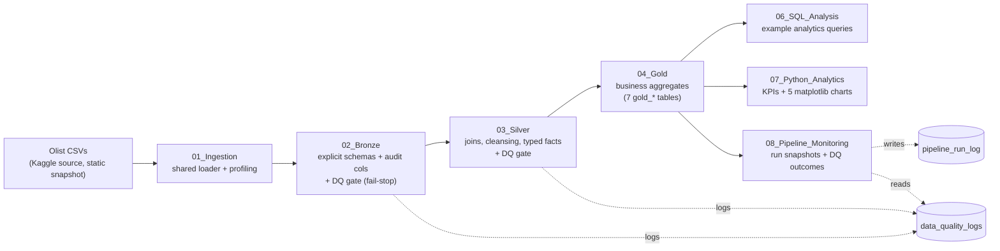

# Olist E-commerce Data Pipeline — Medallion Architecture on Databricks

End-to-end data engineering project: raw Brazilian e-commerce CSVs → Bronze → Silver → Gold Delta tables → SQL analytics, Python charts, and data-quality gates — built and verified on **Databricks Free Edition (serverless compute)**.

**Honest scope up front:** this is a portfolio/learning project, not a production deployment. There is no CI/CD, no incremental ingestion, no scheduled runs, and no physical table optimization (each measured as unnecessary or unavailable at this data scale — see [Limitations](#limitations)). Every claim below was measured or executed in the workspace.

## Architecture



*Bronze writes are full-snapshot overwrites — idempotent for this static dataset (no change key exists, so incremental loading was deliberately not implemented).*

---

## Repository Structure (actual)

```text
Project/
├── 01_Ingestion            # exploratory load + profiling (shared helpers)
├── 02_Bronze               # raw Delta layer: explicit schemas, audit cols, DQ gate
├── 03_Silver               # cleansed/typed fact + dimension tables, DQ gate
├── 04_Gold                 # 7 business aggregate tables
├── 05_Optimization         # measured performance audit (no tuning applied — see notebook)
├── 06_SQL_Analysis         # example SQL analytics queries
├── 07_Python_Analytics     # PySpark → small pandas → 5 matplotlib charts (PNGs)
├── 08_Pipeline_Monitoring  # manual monitoring: run snapshots + DQ outcomes
├── config/
│   ├── pipeline_config.yaml # pipeline settings (some sections unused — documented)
│   └── table_schemas.py     # explicit CSV schemas → deterministic Bronze loads
├── utils/common_functions.py  # shared loader, writer, validators
├── data_quality/quality_checks.py  # DQ framework with severity model
├── tests/test_transformations.py   # 13 tests (synthetic data only)
├── monitoring/pipeline_monitoring.sql  # monitoring queries (all validated)
├── analytics_charts/       # generated chart PNGs (gitignored)
├── Data/                   # raw Olist CSVs — NOT for redistribution (gitignored)
└── databricks.yml          # asset-bundle draft — never deployed (see notes)
```

---

## Feature Status — Implemented / Partially Implemented / Planned

| Feature | Status | Details |
|---|---|--- |
| Medallion ETL (Bronze → Silver → Gold) | ✅ Implemented | 17 Delta tables; rerun-idempotent (full-snapshot overwrite) |
| Explicit CSV schemas (deterministic loads) | ✅ Implemented | `config/table_schemas.py`; byte-identical to prior inferSchema loads (verified) |
| Shared utility module | ✅ Implemented | `utils/common_functions.py` (loader, writer, validators) imported by notebooks |
| Data-quality framework | ✅ Implemented | `data_quality/quality_checks.py`: required/null/duplicate/date/referential/reconciliation checks, **severity model** (fail blocks, warn logs) |
| DQ gates in notebooks | ⚠️ Partially | Bronze + Silver gates executed and logging to `data_quality_logs`; **Gold gate written but not yet executed** |
| Unit tests | ✅ Implemented | `tests/test_transformations.py`: 13 tests on synthetic data, all passing |
| SQL analytics | ✅ Implemented | `06_SQL_Analysis` example queries (monthly revenue, top products/categories/cities) |
| Python charts | ✅ Implemented | `07_Python_Analytics`: 5 matplotlib PNGs + KPI summary, executed |
| Monitoring | ⚠️ Partially | Manual only: `08_Pipeline_Monitoring` snapshots (status/row counts/DQ) to `pipeline_run_log`; **no schedule, no alerts** |
| Performance optimization | ⚠️ Partially | `05_Optimization` = measured audit (39.7 MB total data). **No OPTIMIZE/ZORDER/partitioning applied — deliberately** (single-file tables; findings documented in notebook) |
| Asset Bundle (`databricks.yml`) | ⚠️ Partially | Draft only — **never deployed**; contains paths/compute that need fixing before it would validate |
| CI/CD | ❌ Planned | None exists |
| Incremental ingestion | ❌ Planned (deliberately) | Source CSVs have no change key/timestamp — full snapshot is correct here |
| Scheduled pipeline runs | ❌ Planned | Job exists but runs manually (no schedule configured) |
| ML models / dev-staging-prod catalogs | ❌ Planned | Future work |

---

## Data Source & Attribution

* **Dataset:** *Olist Brazilian E-commerce* public dataset (≈100k orders, 2016–2018), distributed via Kaggle.
* **License note:** the CSVs live in `Data/` for local execution but are **gitignored** — do not redistribute them. Download them yourself from the Kaggle dataset page and place them in `Data/`, then check Kaggle's dataset terms for your own use.
* No credentials, tokens, or personal keys are needed to run this project — it runs on a free Databricks workspace with serverless compute.

## Setup

1. **Workspace:** any Databricks Free Edition (or similar) workspace with **serverless compute** — no cluster configuration required. Notebooks were verified on Spark 4.2 / Python 3.12 (serverless, AWS).
2. **Data:** download the Olist CSVs from Kaggle and place them under `Data/` with the original file names (e.g. `olist_orders_dataset.csv`).
3. **Paths:** notebooks reference `/Workspace/Users/<your-email>/Project/...`. Replace `<your-email>` (or the whole prefix) with your own workspace path — see the publish guide for a one-line `grep` fix.
4. **Run order:** `02_Bronze` → `03_Silver` → `04_Gold` (each ends with a data-quality gate), then optionally `06_SQL_Analysis`, `07_Python_Analytics`, `08_Pipeline_Monitoring`. `01_Ingestion` is exploratory and not required.
5. **Tests:** open `tests/test_transformations.py` and Run All — 13 tests, all self-contained on synthetic data (no pipeline tables touched).

Dependencies: PySpark, matplotlib, pandas, PyYAML — **all preinstalled** in Databricks serverless runtimes; no `%pip install` needed.

---

## Data-Quality Rules (as implemented)

Each pipeline notebook ends with a **quality gate**: it reads the tables it just wrote, runs the checks below, appends every outcome to the `data_quality_logs` Delta table, and **raises an error (stopping the notebook) on any failed `fail`-severity check**. `warn`-severity failures log and continue.

| Check | What it enforces | Example tables |
|---|---|---|
| `check_required_columns` | expected columns exist | all layers |
| `check_null_keys` | primary-key columns contain no nulls | `bronze_orders.order_id`, `silver_order_complete` keys |
| `check_duplicates` | no duplicate rows at table grain | **known warning:** `bronze_review` duplicates — real finding from the source CSV, preserved in bronze (raw layer keeps it; severity = warn) |
| `check_valid_dates` | dates inside sane bounds | silver order dates |
| `check_nonnegative_values` | no negative money/quantities | silver price, revenue, freight |
| `check_referential_integrity` | foreign keys resolve | order→customer, order→product |
| `check_financial_reconciliation` | per order: items+freight == payments (tolerance for rounding) | silver vs bronze payments |

Bronze + Silver gates have executed and logged (bronze shows exactly 1 expected warning, 0 blocking failures; silver 8/8 passed). The Gold gate is written but not yet executed — marked partial in the status table.

---

## Validated KPIs (definitions + verified values)

These definitions were reconciled across Gold tables during the audit (all values cross-checked to the cent against Σ monthly and Σ daily revenue):

| KPI | Definition | Value (live-read) |
|---|---|---|
| Total orders | distinct `order_id` with ≥1 item row in the Silver fact table | 97,276 |
| Total revenue | **item revenue** — Σ price × quantity (excludes freight) | R$ 13,411,973.45 |
| Customers | distinct `customer_id` (1:1 with orders in Olist) | 97,276 |
| AOV (true) | revenue ÷ orders | R$ 137.88 |
| AOV (as stored) | Gold build divides by item rows — known bug, fix pending | R$ 132.84 |

**Known caveats (documented, fixes pending):** the fact table currently includes `canceled`/`unavailable` orders; the stored AOV denominator is wrong. Both are flagged in the notebooks with the corrected values shown alongside — included in the README deliberately: an honest audit is part of the project.

## Tests

`tests/test_transformations.py` — 13 tests covering revenue calculation, joins, aggregations, dedup, and the 8 data-quality checks on **synthetic data only** (no production tables touched). Run All in the file editor: **13/13 passing** (last verified run).

---

## Analytics Outputs

**SQL (`06_SQL_Analysis`):** example dashboard-style queries over the Gold tables — monthly revenue trend, top products, top categories, top cities, and the KPI summary.

**Python charts (`07_Python_Analytics`, all executed):** PySpark aggregates first, only small results converted to pandas, then matplotlib. Five PNGs written to `analytics_charts/` (also rendered inline):

| Chart | File |
|---|---|
| Monthly revenue trend (R$ millions) | `01_monthly_revenue_trend.png` |
| Daily sales trend + 30-day rolling average | `02_daily_sales_trend.png` |
| Top 10 products by revenue | `03_top_10_products.png` |
| Top 10 categories by revenue | `04_top_10_categories.png` |
| Top 10 cities by revenue | `05_top_10_cities.png` |

Each chart cell self-tests (row counts, sort order, non-empty PNG); a final cell verifies all five files exist.

**Monitoring (`08_Pipeline_Monitoring`, manual):** Run All appends one snapshot row per layer to `pipeline_run_log` (timestamp, row counts, DQ pass/fail/blocking, status) and displays run history, failed checks, and bronze freshness. `monitoring/pipeline_monitoring.sql` holds 8 validated queries over the same real tables for the SQL editor. **Nothing is scheduled or alerting** — it is an on-demand check, by design.

---

## Limitations

**Honest scope — what this project is NOT:**

* **Not a production deployment.** No CI/CD, no orchestration-as-code, no environment promotion (dev/staging/prod catalogs referenced in `pipeline_config.yaml` do not exist).
* **No incremental ingestion — deliberately.** The source CSVs are a static snapshot with no change key or updated_at; full-snapshot overwrites are the correct (and idempotent) pattern here. Verified: reruns produce byte-identical tables.
* **No physical table optimization — deliberately.** `05_Optimization` is a measured audit: all 17 tables total **39.7 MB**, each a single file, so OPTIMIZE/Z-ORDER/liquid clustering/partitioning would add cost without benefit (AQE is always on; Spark tuning configs are locked down in serverless anyway). Full evidence, plans, and rollback steps are in that notebook.
* **Monitoring is manual.** `08_Pipeline_Monitoring` + `pipeline_monitoring.sql` record status/row-counts/DQ outcomes on demand; no schedule, no alerts. The existing Databricks Job runs the pipeline manually (no cron).
* **Gold-layer KPI caveats:** stored AOV uses an item-row denominator (true AOV R$ 137.88 vs stored R$ 132.84 — both shown in the KPI notebook); `canceled`/`unavailable` orders are currently included in the fact table. Fixes are planned.
* **Source-data quirks preserved, not silently "fixed":** `bronze_review` keeps string-typed date columns (~8.8k malformed rows in the source CSV) and its known duplicates, with a warning logged.
* **`databricks.yml` is an undeployed draft** — its notebook paths, wheel build, and classic-cluster spec would need rework before `bundle validate` could pass. Kept for transparency about intended direction.

## Future Improvements

* Fix the Gold AOV denominator and add an order-status filter (delivered-only revenue view) behind a config flag
* Execute the written Gold quality gate; add DQ trend queries to the monitoring notebook
* Add a cron schedule to the existing Job (Jobs run fine on this workspace — verified) and wire 08_Pipeline_Monitoring as its final task
* Rewrite `databricks.yml` for serverless compute and deploy via bundles for real environment promotion
* ML extensions on the Silver fact table: churn, demand forecasting, recommendations

---

## Publishing This Repo (privacy first)

A security/privacy pass was done before publishing:

* **No credentials, tokens, or PATs** exist in any project file (verified: empty webhook fields only, no secrets anywhere).
* **`databricks.yml`** — the workspace host URL and notification emails are **placeholders** in the published copy (the workspace-specific values were scrubbed; nothing in the file is used at runtime anyway — the bundle was never deployed).
* **`pipeline_config.yaml`** — the personal email under `alerting` is a placeholder in the published copy (that section is unused by the pipeline — documented in the audit).
* **Notebook paths** contain a personal workspace prefix (`/Workspace/Users/<email>/Project/...`). Publishing copies replace the email with `<your-email>`; if you clone this repo, run this once inside your local copy:

```bash
grep -rl "<your-email>" . | xargs sed -i "s|/Workspace/Users/<your-email>/Project|/Workspace/Users/your.email/Project|g"
```

* **Raw data stays out of git:** create a `.gitignore` in the repo root before your first commit (contents below) — keeps the Olist CSVs out (dataset terms + repo size) and the chart PNGs regenerable:

```gitignore
Data/
analytics_charts/
.bundle/
__pycache__/
*.pyc
.pytest_cache/
*.env
.env*
secrets*
*.token
*.pem
```

Charts are small — if you want them visible on GitHub, force-add them or commit a `docs/screenshots/` folder.

**Publish steps:**

```bash
# from your local clone of the workspace folder
cd Project
git init -b main
git add . && git status          # confirm Data/ and analytics_charts/ are ignored
git commit -m "Olist medallion pipeline: ETL, DQ gates, tests, analytics"
gh repo create olist-medallion-pipeline --public --source=. --push
```

Or create the repo on github.com and `git remote add origin ... && git push -u origin main`.

**Screenshots/charts worth including in the README or a `docs/` PR:** the 5 chart PNGs (monthly revenue, daily trend + rolling avg, top products/categories/cities), the 08_Pipeline_Monitoring dashboard output (run history + DQ outcomes), and — if you like — the Databricks Job DAG (5 tasks, Ingestion→Gold→SQL analysis) with its successful run history. Keep workspace URLs/emails out of any screenshot (crop or blur the browser path bar).

---

## Quick Reference

```python
# import the shared helpers (any pipeline notebook)
import sys
sys.path.append("/Workspace/Users/<your-email>/Project/utils")
from common_functions import load_csv, write_delta_table, validate_dataframe

from data_quality.quality_checks import DataQualityChecker   # framework used by the gates
```

The in-notebook gates call `DataQualityChecker` with `severity='fail'` (stops the notebook) or `'warn'` (logs to `data_quality_logs`) — that logic already lives at the bottom of 02/03/04; no extra wiring needed.

---

## Acknowledgements

* Olist for publishing the dataset and Kaggle for hosting it.
* Built on Databricks Free Edition — serverless compute only (no cluster configuration was ever needed).

*The phased build plan that this README replaced is preserved in workspace/git history, not repeated here — the status table above reflects what actually shipped.*

## 🚀 Quick Start Commands

### Import utilities in any notebook:
```python
import sys
sys.path.append("/Workspace/Users/<your-email>/Project/utils")
from common_functions import *
from data_quality.quality_checks import DataQualityChecker
```

### Load configuration:
```python
config = load_config()
catalog = config['catalog']['name']
```

### Run quality checks:
```python
qc = DataQualityChecker(spark)
passed, results = qc.check_null_values(df, ['order_id'])
qc.save_results()
```

### Run tests:
```python
%run /Workspace/Users/<your-email>/Project/tests/test_transformations.py
```

---

## 📞 Support & Questions

For questions or issues:
1. Check the Feature Status and Limitations sections of this README
2. Run 08_Pipeline_Monitoring for pipeline health
3. Check data_quality_logs table for quality issues
4. Open a GitHub issue on the repo (pipeline data issues should surface through the quality gates, not manual inspection)

---

*Last verified: 2026-10-10 - every number in this README was measured in the build workspace*  
*Maintained by the author - reach out via GitHub issues on the repo. Code license: MIT; the Olist dataset is not covered (see Kaggle terms)*